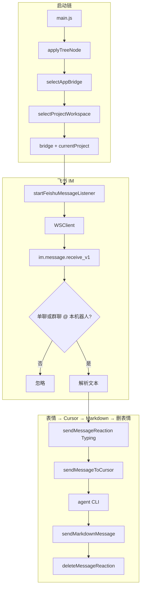
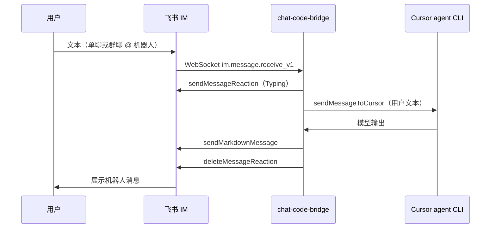

# chat-code-bridge

将 **即时通讯（飞书 / 企业微信）** 与本地 **Cursor Agent CLI** 桥接的 Node 项目：收到聊天消息后调用本机 `agent`，再把模型输出写回会话。

| 能力 |
| --- |
| 飞书 IM |
| 企业微信 |
| Cursor |

**快速导航：** [环境要求](#环境要求) · [快速开始](#快速开始) · [目录结构](#目录结构说明) · [数据流](#数据流) · [消息发送 API](#消息发送)

---

## 环境要求

- **Node.js**：建议当前 LTS；本项目为 ES Module（`package.json` 中 `"type": "module"`）。
- **Cursor Agent CLI**：PATH 中需有名为 `agent` 的可执行文件（与代码中 `spawn('agent', …)` 一致）。
- **飞书应用**（若选飞书）：自建应用、机器人能力，按开放平台配置 `appId` / `appSecret` / `domain`。另外，事件订阅需监听以下两个事件：
  - `im.chat.access_event.bot_p2p_chat_entered_v1`
  - `im.message.receive_v1`
- **企业微信机器人**（若选企微）：后台获取 `botId`、`secret`，与 `@wecom/aibot-node-sdk` 要求一致。

---

## 快速开始

```bash
npm install
npm run dev
```

按提示依次选择：**桥接平台**（飞书 / Lark 国际版 / 企业微信）→ **项目 workspace**。凭证不全时会交互补全并写回用户侧配置；首次运行会展开默认配置树。

**入口行为（与 `main.js` 一致）：**

- `bridge.key === 'feishu'` → `startFeishuMessageListener(bridge)`
- `bridge.key === 'wecom'` → `startWecomMessageListener(bridge)`

菜单中的 **「Lark（飞书国际版）」** 与飞书共用同一套 Lark SDK；若需从菜单启动国际版，请在 `main.js` 中增加 `bridge.key === 'lark'` 分支并同样调用 `startFeishuMessageListener(bridge)`（凭证字段与 `Client` 一致）。

---

## 目录结构说明

```
chat-code-bridge/
├── main.js                         # 入口：applyTreeNode → selectAppBridge → selectProjectWorkspace → 按 key 启动监听
├── package.json
├── package-lock.json
├── README.md
├── .gitignore
├── utils/
│   ├── applyTreeNode.js
│   ├── getUserBridgeConfigPath.js
│   ├── readCofig.js                # 读取用户侧桥接配置
│   ├── writeConfig.js              # 点路径合并写入用户配置
│   └── writeLog.js                 # 按日落盘运行日志
├── .vscode/
│   └── settings.json
├── src/
│   ├── chatApp/
│   │   ├── index.js                # selectAppBridge：菜单选桥接、读/写用户配置
│   │   ├── feishu/
│   │   │   ├── index.js            # startFeishuMessageListener：WS + 消息 → Cursor → 回写
│   │   │   └── send-message/       # 文本 / 富文本 Markdown / 卡片 / 表情
│   │   ├── lark/
│   │   │   ├── index.js            # 再导出 startLarkMessageListener（同 feishu）
│   │   │   └── send-message/       # 自 feishu 再导出（当前无 sendMarkdownMessage 再导出）
│   │   └── wecom/
│   │       └── index.js            # startWecomMessageListener（@wecom/aibot-node-sdk）
│   └── aiCode/
│       └── cursor/
│           ├── index.js            # sendMessageToCursor / sendMessageToCursorImpl（agent CLI）
│           └── check-workspace.js  # selectProjectWorkspace，写入 currentProject
└── node_modules/
```

### 各目录用途摘要

| 路径 | 用途 |
| --- | --- |
| `utils/` | 配置路径、读写用户配置、日志 |
| `src/chatApp/feishu/` | 飞书监听与消息发送实现 |
| `src/chatApp/lark/` | 与 feishu 同逻辑的命名空间再导出 |
| `src/chatApp/wecom/` | 企业微信监听与流式回复 |
| `src/aiCode/cursor/` | Cursor Agent CLI 与会话文件、workspace 选择 |

---

## 数据流

### 进程启动

1. `main.js` 通过 `applyTreeNode` 将默认配置树展开到用户环境。
2. `selectAppBridge()` 载入可选桥接定义；凭证优先来自 `readCofig`，缺失则交互输入并由 `writeConfig` 写回。
3. `selectProjectWorkspace()`（`check-workspace.js`）载入项目 workspace 列表，将选中项写入用户配置中的 `currentProject`。
4. 按 `bridge.key` 调用飞书或企业微信监听。

### 飞书：消息 → Cursor → 回写

长连接 `WSClient` 处理 `im.message.receive_v1`：仅处理单聊，或群聊中 **@ 本机器人** 的消息。处理顺序与 `src/chatApp/feishu/index.js`、`src/aiCode/cursor/index.js` 一致：

1. `writeLog` 记录原始事件（可选调试用）。
2. 解析文本与 `chat_id` / `message_id`；无文本则返回。
3. `sendMessageReaction`：对原消息添加 **`Typing`** 表情。
4. `sendMessageToCursor`：根据用户配置中的 **`currentProject.workspace`**（无则回退 `process.cwd()`）调用 `agent`；会话持久化以便 `--resume`。
5. 使用 **`sendMarkdownMessage`**（`msg_type: post`，富文本 `md` 段）将结果发回同一 `chat_id`。
6. `deleteMessageReaction`：移除第 3 步的 Typing 表情。



### 企业微信：消息 → Cursor → 流式回写

`startWecomMessageListener` 使用 `AiBot.WSClient`：收到文本后先 `replyStream` 中间提示，再 `sendMessageToCursorImpl` 拉取完整回复，最后以流式结束标记发回（详见 `src/chatApp/wecom/index.js`）。

### 端到端时序（飞书）



---

## 消息发送

实现在 **`src/chatApp/feishu/send-message/`**；`lark/send-message` 为再导出（与 feishu 对齐的部分）。调用方传入已配置好的 `Client`，模块内不写密钥。

| 模块 | 导出 | 说明 |
| --- | --- | --- |
| `sendTextMessage.js` | `sendTextMessage` | `im.v1.message.create`，`msg_type: text` |
| `sendMarkdownMessage.js` | `sendMarkdownMessage` | `msg_type: post`，富文本中 `md` 段渲染 Markdown（列表、代码块等） |
| `sendInteractiveCardMessage.js` | `sendInteractiveCardMessage` | `msg_type: interactive`，或 `defaultCard` 快捷生成 |
| `sendMessageReaction.js` | `sendMessageReaction` / `deleteMessageReaction` | 消息表情创建与删除 |

---

## 新增记录

约定：有功能合并或发布时，在表格**顶部**追加一行（最新在上）。

| 日期 | 说明 |
| --- | --- |
| 2026-04-09 | README 补充飞书事件订阅要求：若选择飞书平台，需监听 `im.chat.access_event.bot_p2p_chat_entered_v1` 与 `im.message.receive_v1`。 |
| 2026-04-07 | 文首「能力」表去掉「说明」列，仅保留能力名称列。 |
| 2026-04-07 | README 删除「用户目录配置」整节，并弱化正文中的家目录路径表述。 |
| 2026-04-07 | 重写 README：对齐 `main.js`（飞书 / 企微、`selectProjectWorkspace`、`sendMarkdownMessage`、企微 SDK）、补充 workspace 选择与 `writeLog`；说明 Lark 菜单项与入口分支关系。 |
| 2026-04-07 | 数据流与源码对齐：去掉已不存在的 `message_id` 去重描述；表情为 `Typing`；会话文件为 `chat-code-bridge-session.json`；新增 `docs/feishu-project-overview.md` 供飞书文档导入。 |
| 2026-04-06 | 「数据流」补充 `message_id` 去重步骤；流程图与时序图与 `feishu/index.js` 对齐；增加本节总述。 |
| 2026-04-06 | `README.md` 目录结构按当前仓库更新：`lark/` 为再导出、`feishu/` 为发送实现；各目录摘要与「功能说明」同步。 |
| 2026-04-06 | `README.md` 文首增加快速导航；「数据流」补充参与者时序图（sequenceDiagram）。 |
| 2026-04-06 | `README.md` 新增「数据流」：启动链、飞书 WS → Cursor Agent CLI → 回写文本；附 Mermaid 示意图；说明 `lark/` 与当前入口关系。 |
| 2026-04-06 | `README.md` 同步整体目录结构：`utils/`、`feishu`/`lark` 双轨 `send-message`、`aiCode/cursor`；更新入口与表格说明；移除已不存在的 `lark-cli`/`cursor-cli` 与 `main copy 2.js` 描述。 |
| 2026-04-06 | `README.md` 补充「功能说明」：三个发送相关模块的用途、接口要点；目录树同步 `sendInteractiveCardMessage.js`。 |
| 2026-04-06 | 新增 `sendInteractiveCardMessage.js`：发送 `interactive` 卡片（自定义 `content` 或 `defaultCard`）。 |
| 2026-04-06 | 新增根目录 `README.md`：目录结构说明与「新增记录」模板。 |
| 2026-04-06 | 初版 `send-message`：文本消息、消息表情回复；导出为异步箭头函数。 |
