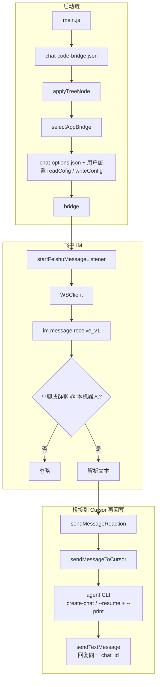
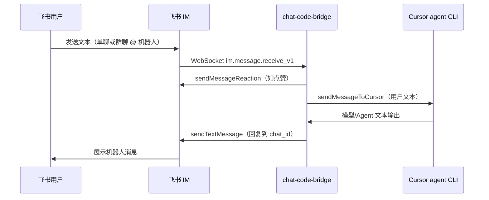

# chat-code-bridge

飞书（Lark）与代码侧能力桥接的 Node 项目：使用 `@larksuiteoapi/node-sdk` 处理即时消息等场景。

**快速导航：** [目录结构](#目录结构说明) · [数据流](#数据流) · [功能说明](#功能说明)

---

## 目录结构说明

```
chat-code-bridge/
├── main.js                      # 应用入口：读取 config、应用用户目录占位符、选择桥接应用、启动飞书消息监听（开发：`npm run dev`）
├── package.json                 # 项目元数据与脚本（ES Module：`"type": "module"`）
├── package-lock.json            # 依赖锁定文件
├── README.md                    # 本说明
├── .gitignore                   # Git 忽略规则
├── config/                      # 运行时配置（桥接树、聊天选项等）
│   ├── chat-code-bridge.json    # 桥接配置根（可被 applyTreeNode 展开到用户目录等）
│   └── chat-options.json        # 可选桥接应用列表与交互菜单所需元数据
├── utils/                       # 通用工具（配置路径、读写、树节点展开）
│   ├── applyTreeNode.js
│   ├── getUserBridgeConfigPath.js
│   ├── readCofig.js
│   └── writeConfig.js
├── .vscode/                     # VS Code / Cursor 工作区设置（编辑器相关）
│   └── settings.json
├── src/
│   ├── chatApp/                 # 聊天应用侧：桥接选择、飞书 / Lark IM 封装
│   │   ├── index.js             # 选择并装配当前使用的 AppBridge（读配置、交互菜单等）
│   │   ├── feishu/              # 飞书场景入口与能力封装
│   │   │   ├── index.js         # 飞书消息监听等入口
│   │   │   └── send-message/    # 发送消息相关封装（与 lark 目录下模块职责对称）
│   │   │       ├── sendTextMessage.js
│   │   │       ├── sendInteractiveCardMessage.js
│   │   │       └── sendMessageReaction.js
│   │   └── lark/                # Lark 命名空间下的同类能力（与 feishu 并列，便于区分场景或迁移）
│   │       ├── index.js
│   │       └── send-message/
│   │           ├── sendTextMessage.js
│   │           ├── sendInteractiveCardMessage.js
│   │           └── sendMessageReaction.js
│   └── aiCode/                  # 与 AI 编程 / Cursor 侧对接的代码（与 chatApp 解耦）
│       └── cursor/
│           └── index.js         # Cursor 侧会话与消息处理等
└── node_modules/                # npm 依赖（以 package.json 为准；勿手写业务到此目录）
```

### 各目录用途摘要

| 路径 | 用途 |
| --- | --- |
| 项目根目录 | 入口脚本、包配置、说明文档 |
| `config/` | `chat-code-bridge.json` 桥接树；`chat-options.json` 桥接选项与菜单 |
| `utils/` | 配置路径解析、读写、配置树中用户目录类占位符展开 |
| `src/chatApp/` | 桥接选择、飞书与 Lark 两套 IM 封装入口 |
| `src/chatApp/feishu/`、`src/chatApp/lark/` | 各自 `index.js` 为场景入口；`send-message/` 为发消息、卡片、表情等原子能力 |
| `src/aiCode/cursor/` | 与 Cursor / 代码智能体侧交互的逻辑 |
| `.vscode/` | 编辑器配置，可按个人习惯调整 |

---

## 数据流

### 进程启动

1. `main.js` 读取 `config/chat-code-bridge.json`，经 `applyTreeNode(homedir(), …)` 把配置树里的用户目录类占位符展开为实际路径。
2. `selectAppBridge()`（`src/chatApp/index.js`）读取 `config/chat-options.json` 展示可选桥接；凭证优先来自用户目录配置（`readCofig`），缺失则交互输入并 `writeConfig` 写回。
3. 将得到的 `bridge`（含 `appId` / `appSecret` / `domain`）交给 `startFeishuMessageListener(bridge)`（`src/chatApp/feishu/index.js`）。

### 飞书消息 → Cursor → 飞书回复

当前入口在飞书侧：长连接 `WSClient` 订阅 `im.message.receive_v1`；仅处理「单聊」或「群聊里 @ 本机器人」的消息，解析出纯文本后依次：

1. `sendMessageReaction`：对原消息点表情（如 `THUMBSUP`），表示已收到。
2. `sendMessageToCursor(text)`（`src/aiCode/cursor/index.js`）：通过本机 **Cursor Agent CLI**（默认可执行名 `agent`，可用 `CURSOR_AGENT_BIN` 覆盖）在同一工作区复用会话；会话 id 落在 `~/.chat-code-bridge/cursor-agent-session.json`；工作区目录由 `CURSOR_AGENT_WORKSPACE` 指定，默认 `process.cwd()`。
3. `sendTextMessage`：把 Agent 返回的文本发回对应会话（`chat_id`）。



（图中 `agent CLI` 步骤对应环境变量 `CURSOR_AGENT_BIN`，工作区对应 `CURSOR_AGENT_WORKSPACE`。）

`src/chatApp/lark/` 提供与 `feishu/send-message` 对称的发送能力封装；**当前 `main.js` 仅挂载飞书监听**，未单独启动 `lark/index.js` 的同类流程时，上图中「长连接入口」以 `feishu/index.js` 为准。

### 端到端时序（参与者视角）

与上图同一链路，按「谁与谁对话」展开，便于和日志、抓包对照。



---

## 功能说明

### 消息发送（`src/chatApp/feishu/send-message/` 与 `src/chatApp/lark/send-message/`）

两套目录下模块名与职责一致，便于在不同入口或迁移阶段复用；基于 `@larksuiteoapi/node-sdk` 的 `Client`，将常用 IM 能力封装为异步函数。**调用方自行创建并传入已配置 `appId` / `appSecret`（及 `domain` 等）的 `Client`**，模块内不写密钥。

| 模块 | 导出 | 能力简述 |
| --- | --- | --- |
| `sendTextMessage.js` | `sendTextMessage` | 发送 **文本** 消息：`im.v1.message.create`，`msg_type: text`，`content` 为 `JSON.stringify({ text })`。参数：`receiveId`、`receiveIdType`（默认 `chat_id`）、`text`。 |
| `sendInteractiveCardMessage.js` | `sendInteractiveCardMessage` | 发送 **可交互卡片**：`msg_type: interactive`。支持两种方式二选一：`content`（完整卡片 JSON 字符串或可 `JSON.stringify` 的对象），或 `defaultCard: { title, content }`（内部使用 `Lark.messageCard.defaultCard` 生成简易蓝头 Markdown 卡片）。 |
| `sendMessageReaction.js` | `sendMessageReaction` | 给 **指定消息** 添加 **表情回复**：`im.v1.messageReaction.create`。参数：`messageId`、`emojiType`（飞书预置表情标识，如 `THUMBSUP`、`Get` 等）。需具备相应 `im:message` 表情写权限。 |

---

## 新增记录

> 约定：每次合并或发布有意义的功能时，在**表格顶部**追加一行（最新的在最上面），便于快速了解项目演进。

| 日期 | 说明 |
| --- | --- |
| 2026-04-06 | `README.md` 文首增加快速导航；「数据流」补充参与者时序图（sequenceDiagram）。 |
| 2026-04-06 | `README.md` 新增「数据流」：启动链、飞书 WS → Cursor Agent CLI → 回写文本；附 Mermaid 示意图；说明 `lark/` 与当前入口关系。 |
| 2026-04-06 | `README.md` 同步整体目录结构：`config/`、`utils/`、`feishu`/`lark` 双轨 `send-message`、`aiCode/cursor`；更新入口与表格说明；移除已不存在的 `lark-cli`/`cursor-cli` 与 `main copy 2.js` 描述。 |
| 2026-04-06 | `README.md` 补充「功能说明」：三个发送相关模块的用途、接口要点；目录树同步 `sendInteractiveCardMessage.js`。 |
| 2026-04-06 | 新增 `sendInteractiveCardMessage.js`：发送 `interactive` 卡片（自定义 `content` 或 `defaultCard`）。 |
| 2026-04-06 | 新增根目录 `README.md`：目录结构说明与「新增记录」模板。 |
| 2026-04-06 | 初版 `send-message`：文本消息、消息表情回复；导出为异步箭头函数。 |
